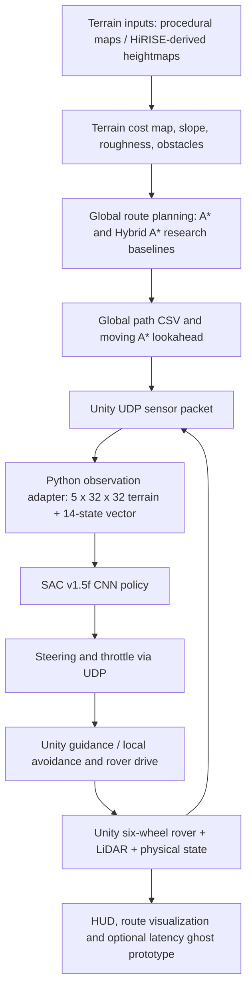

# Autonomous Mars Rover Navigation — Python/PyBullet + Unity

**Research-oriented six-wheel Mars rover simulation combining classical path planning, terrain-aware reinforcement learning, and a Unity–Python control bridge.**

This repository contains the **completed Phase 1** of our autonomous Mars rover project. It brings together terrain generation and processing, A* / D* Lite / Hybrid A* planning, reinforcement-learning baselines, a curriculum-trained SAC-CNN controller, and a six-wheel Unity demonstration. The advanced uncertainty-aware recurrent SAC / Hybrid A* training work is a **separate Phase 2 project** and is **not represented here as completed or integrated into Unity**.

> **Included pretrained model:** This repository is configured to include **one** Git LFS checkpoint: `Python/checkpoints/sac_v15f/seed_71/best/best_model.zip` (the selected SAC v1.5f model). Old training snapshot ZIPs, patch bundles, and replay archives remain excluded. Clone with Git LFS to retrieve the actual model rather than a text pointer.

## What is implemented

| Area | Phase 1 implementation |
|---|---|
| Classical navigation | A*, D* Lite demonstration, Hybrid A* comparison and cost-map-based terrain route planning |
| Terrain | Procedural easy/medium/hard maps; train/validation/test splits; preparation pipeline for HiRISE Jezero Crater elevation rasters |
| Physics and sensing | PyBullet rover environment; obstacle/terrain costs; six-wheel rover surrogate; Unity WheelCollider rover, LiDAR-style grid sensing and rover-state telemetry |
| RL baselines | A*+D3QN, PPO-CNN and SAC-CNN training/evaluation implementations |
| Refined learned controller | SAC v1.5f, curriculum learning, teacher-demonstration/behavior-cloning bootstrap and protected successful replay |
| Navigation integration | Global path CSV, moving A* lookahead target, Python SAC inference via UDP, and Unity control/safety logic |
| Dynamic environment | Runtime rock spawning, local route guidance/avoidance assistance and path visualization |
| Visual feedback | Unity rover HUD and a latency/delayed/predictive ghost prototype in C# (not a validated operator study) |
| Evidence | Source for reproducible benchmarks and saved metrics/figures where available; no unverified performance claims |

**Important scientific distinction:** The final Unity controller can combine learned SAC actions with deterministic local guidance or safety assistance. The final demonstration should not be described as an end-to-end, exclusively learned SAC controller in all operating modes. The `LatencyGhost.cs` component implements kinematic prediction, but its presence in code does **not** establish that a controlled teleoperation/latency study was conducted.

## High-level architecture



### Policy observation interface

The **Phase 1 SAC v1.5f** bridge uses these inputs (not the later Phase 2 recurrent observation format):

- **Terrain:** `uint8` array of shape **`(5, 32, 32)`**: relative elevation, slope, roughness, Unity LiDAR occupancy, and a reserved zero-filled channel.
- **Rover state:** `float32` vector of shape **`(14,)`**: goal distance, sine/cosine of the **moving A* lookahead** bearing, forward/lateral velocity, yaw rate, roll, pitch, slip, battery proxy, previous steering/throttle, and two reserved zeros.
- **Actions:** continuous steering and throttle. The bridge preserves the **positive steering = rover-left** convention.
- **Guidance:** the final v1.5f Unity transfer uses an approximately **6 m path lookahead**, configured in the Unity Inspector.

The Python training code is found in `Python/scripts/36_train_sac_v15f.py`, benchmark code in `Python/scripts/37_benchmark_sac_v15f.py`, and the transfer bridge in `Python/unity_sac_bridge_v15f.py` (a memory-conscious variant is also available in `Python/scripts/unity_sac_bridge_v15f_lowmem.py`).

## Repository layout

```text
.
├── README.md                       # This single project guide
├── .gitignore                      # Generated files and obsolete archives excluded
├── .gitattributes                  # Git LFS patterns for large binary assets
├── Python/
│   ├── mars_rover/                # Terrain, physics, planners, RL features and environment
│   ├── scripts/                   # Classical demos, RL baselines, SAC v1.5f and benchmarks
│   ├── assets/                    # Rover URDF and related model assets
│   ├── data/                      # Terrain splits and required research datasets
│   ├── unity_hirise_export/       # Heightmap and navigation scene export for Unity
│   ├── outputs/                   # Available classical results/figures
│   ├── results/                   # Available RL benchmark outputs
│   ├── checkpoints/sac_v15f/seed_71/best/best_model.zip  # Git LFS
│   ├── unity_sac_bridge_v15f.py   # Main Python–Unity inference bridge
│   ├── requirements.txt           # Consolidated environment dependencies
│   └── pyproject.toml             # Python package metadata
└── Unity/
    ├── Assets/                    # Scenes, scripts, StreamingAssets, materials and models
    ├── Packages/                  # Unity manifest / locked package dependencies
    └── ProjectSettings/           # Original Unity project settings
```

Only one project README is intentionally maintained at repository root. Old `PHASE2_*` patch notes, trial-specific `README_V15*.txt` files, training logs, archives, intermediate checkpoints, local virtual environments, and Unity `Library` caches are excluded from the cleaned export. **Original projects are never edited by the staging script.**

## Requirements

- **Windows 11** with **Python 3.11** recommended for the original development stack.
- **Unity Editor 6000.3.23f1** (read from `Unity/ProjectSettings/ProjectVersion.txt`).
- Git and Git LFS if cloning the full datasets and Unity binary assets.
- NVIDIA GPU / CUDA is optional for inference; training is significantly faster on a supported GPU. Use a PyTorch build appropriate for your driver/GPU.
- Python dependencies in `Python/requirements.txt` include NumPy, SciPy, Rasterio, PyBullet, Gymnasium, Stable-Baselines3, SB3-Contrib, PyTorch-dependent RL tools, pandas, matplotlib and visualization packages.

### Python installation

From a **PowerShell terminal** at the repository root:

```powershell
cd Python
py -3.11 -m venv .venv
.\.venv\Scripts\Activate.ps1
python -m pip install --upgrade pip
pip install -r requirements.txt
pip install -e .
python scripts\00_check_system.py
```

For CUDA-enabled PyTorch, install the compatible wheel from the [official PyTorch selector](https://pytorch.org/get-started/locally/) rather than assuming one CUDA version works on every PC.

### Run classical path-planning benchmarks

```powershell
cd Python
python scripts\01_make_procedural_terrain.py
python scripts\03_run_classical_benchmarks.py
python scripts\04_dstar_dynamic_demo.py
python scripts\05_pybullet_live_demo.py --planner hybrid
```

The classical benchmark writes `outputs/metrics/classical_metrics.csv`, and the demonstration script opens a PyBullet visualization. Terrain can also be chosen using `--terrain`.

### Reproduce the SAC v1.5f benchmark

With the LFS-backed model downloaded at `Python/checkpoints/sac_v15f/seed_71/best/best_model.zip`:

```powershell
cd Python
python scripts\37_benchmark_sac_v15f.py --seed 71 --episodes 8 --workers 2 --device cpu
```

This evaluates available seed-71 checkpoints in clean and randomized regimes, writing summaries under `Python/results/sac_v15f_seed_71/`. To compare older checkpoint snapshots, those specific snapshots must also be supplied separately. For CUDA, change `--device cpu` to `--device cuda` if supported.

**This is an evaluation script, not a single-episode PyBullet GUI demo.** Refer to `scripts/05_pybullet_live_demo.py` for the classical GUI and `scripts/33_live_sac_v15e.py` for the older v1.5e live-policy demo; those are not automatically a verified v1.5f live-GUI entry point.

## Launch the Unity demonstration

1. Open the `Unity/` folder through **Unity Hub** with **Editor 6000.3.23f1** and let package imports finish.
2. Open `Assets/Scenes/SampleScene.unity`.
3. Check that `Assets/StreamingAssets/` contains `global_path.csv`, v1.5f route CSV files and `v15f_nav_scene.json`.
4. Ensure `Python/unity_hirise_export/height_m.npy` and `heightmap_meta.json` exist, and that you have a compatible SAC checkpoint.
5. Activate the Python environment and, from `Python/`, run:

```powershell
python unity_sac_bridge_v15f.py `
  --model "checkpoints/sac_v15f/seed_71/best/best_model.zip" `
  --height-npy "unity_hirise_export/height_m.npy" `
  --meta "unity_hirise_export/heightmap_meta.json" `
  --device cpu `
  --self-test
```

6. When the self-test passes, rerun the same command **without** `--self-test` and leave the Python bridge running.
7. In Unity, check `UnityUdpBridge` Inspector references, path/goal alignment, action sign, rover and LiDAR components, and UDP ports (**Python listens on 5005; Unity receives on 5006** in the original bridge defaults). Start Play Mode.
8. Verify rover movement and status in `V01HUD`. The final Unity scene may include deterministic local planning assistance in addition to SAC policy output; record which mode is enabled when reporting results.

If terrain-bearing directions appear mirrored, verify coordinate frame conventions and inspect the bridge's `--flip-x` / `--flip-z` options before changing steering signs.

### Key Unity C# classes

| Script | Responsibility |
|---|---|
| `RoverDrive.cs` | Six-wheel propulsion, steering and control application |
| `LidarGridSensor.cs` | Sensor raycasts / local obstacle grid |
| `UnityUdpBridge.cs` | Unity state packets, Python actions, path guidance and control integration |
| `DynamicGuidanceAvoidance.cs` | Local obstacle-aware guidance |
| `RuntimePathRockSpawner.cs`, `AutoRockSpawner.cs` | Runtime/scenario rock placement |
| `GlobalPathRenderer.cs` | Visualizes the global route |
| `V01HUD.cs` | Rover/bridge/control telemetry display |
| `V15fNavSceneExporter.cs` | Navigation-scene export support |
| `LatencyGhost.cs` | Delayed pose and simple forward kinematic ghost prediction prototype |
| `GoalTrigger.cs`, `SnapToTerrain.cs`, `MarsGravity.cs`, `FollowCamera.cs` | Goal, positioning, gravity and visualization support |

The `LatencyGhost.cs` implementation alone is not evidence of a tested human-in-the-loop teleoperation system. Its saved scene enablement and references should be checked before claiming a working interactive ghost demonstration.

## Terrain data and provenance

`Python/scripts/01_make_procedural_terrain.py` produces procedural terrain inputs. `Python/scripts/02_prepare_hirise_geotiff.py` can convert a user-supplied GeoTIFF elevation crop into the `.npz` terrain representation.

The documented external source is the **HiRISE Jezero Crater DTM**, product `DTEEC_045994_1985_046060_1985_U01`, produced by the **Mars Reconnaissance Orbiter HiRISE** program, distributed at [HiRISE's official DTM page](https://hirise.lpl.arizona.edu/dtm/ESP_045994_1985). Credit: **NASA/JPL-Caltech/UArizona**.

Do not assume every Unity terrain or procedural map was directly captured by NASA. Preserve the actual source/processing manifest when making a provenance claim.

## Saved plots, results and reproducibility evidence

This release retains genuine metrics and generated graphs already present in the Phase 1 working tree, including `Python/outputs/figures/`, `Python/outputs/metrics/`, `Python/outputs/paths/`, and `Python/results/` where those folders contain actual files. The staging script copies CSV, JSON/JSONL, PNG/JPEG/WebP, SVG, and PDF research outputs; it does not manufacture missing files. Researchers should distinguish baseline benchmark results from the SAC v1.5f checkpoint evaluation and report seeds, sample sizes, and whether Unity safety-assisted control was enabled.

To verify the published evidence after cloning:

```powershell
Get-ChildItem Python/outputs,Python/results -Recurse -File |
  Select-Object FullName,Length
```

If your local folder does not contain a particular plot, you must run its corresponding evaluation script before publishing it. A plot generated from example/simulated faculty telemetry is **not** evidence of our own measured rover performance.

## Research methods and evaluation

The codebase includes A* and Hybrid A* route planning, a D* Lite-style dynamic replanning demonstration, and three major learned-controller baselines: D3QN, PPO-CNN and SAC-CNN. SAC v1.5f additionally contains successful-demo generation, protected replay, curriculum/stage evaluation and explicit train/test dataset handling.

Useful entry points:

- `Python/scripts/03_run_classical_benchmarks.py` — cost-aware classical planning results.
- `Python/scripts/12_evaluate_phase2.py` — earlier multi-algorithm RL evaluation.
- `Python/scripts/34_generate_v15f_teacher_demos.py` — training-only teacher transitions.
- `Python/scripts/36_train_sac_v15f.py` — the refined SAC experiment.
- `Python/scripts/37_benchmark_sac_v15f.py` — repeated evaluation of saved v1.5f checkpoints.

When preparing a paper or presentation, cite the precise CSV/experiment source and report episode counts, terrain split, seed, checkpoint and safety-mode configuration. Success on a small development set should not be stated as universal generalization. This repository does not claim a validated VR/operator experiment or a statistically demonstrated benefit from ghost visualization.

## Model files and Git LFS

Large arrays (`*.npz`, `*.npy`), raster DEMs (`*.raw`, `*.tif`), and Unity binary models (e.g., `*.glb`) are stored through **Git LFS**. Run `git lfs install` before cloning. A clean clone will fetch actual LFS contents provided the owner has available quota.

To keep the public repository free of historical ZIP archives, `.gitignore` excludes **all other `*.zip` files** and allows exactly this selected checkpoint:

`Python/checkpoints/sac_v15f/seed_71/best/best_model.zip`

The checkpoint is configured in `.gitattributes` as an LFS object. After cloning, use `git lfs pull` if the file appears as a small text pointer. Other checkpoints are intentionally omitted. Saved real figures and metrics are included from `Python/outputs/` and `Python/results/` when present at publication time. No benchmark results are invented or inferred from file names.

## Reproducibility, licensing and acknowledgments

- **Code:** research/student project; verify and add an appropriate code license only after confirming all contributors agree.
- **HiRISE data:** credit **NASA/JPL-Caltech/UArizona** and the original DTM page when used.
- **Third-party Unity assets (including `PolyOne`):** check the original asset license and whether redistribution in a **public** repository is permitted. If it is not permitted, omit those files and document where authorized users can obtain them; the Unity scene may then need that asset installed locally.
- **Large models and data:** confirm GitHub LFS quotas, repository size and file-specific size limits before pushing.
- **Safety:** autonomous control is demonstrated **in simulation**. No real Mars rover or mission-ready autonomy is claimed.

## Project team

NMIMS MPSTME IVRAR PBL Group 14: **Anvay Borade, Ananya Baweja, Mahit Daswani Chanchlani, and Aryan Oberoi**. The project evolved through classical planning, baseline RL, SAC refinement and Unity integration. Individual contributions should be described according to work actually performed.

---

**Scope note:** This repository intentionally publishes a well-defined, reproducible **Phase 1** instead of mixing in active, unfinalized Phase 2 recurrent-SAC training experiments.
